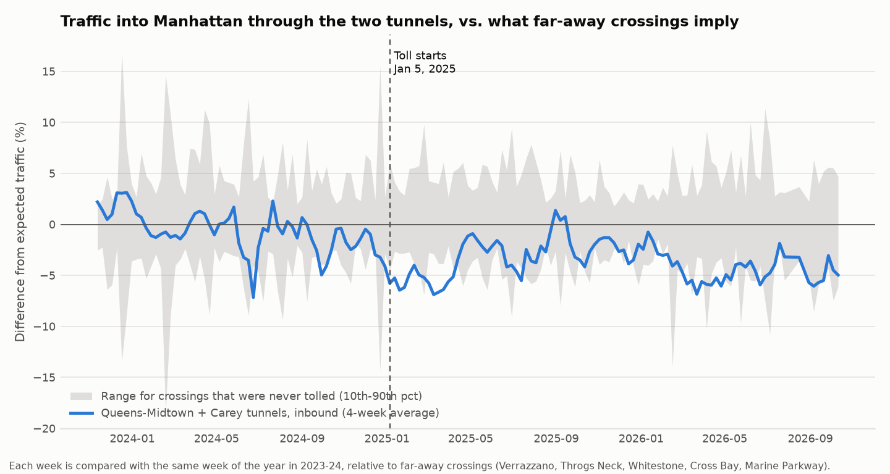
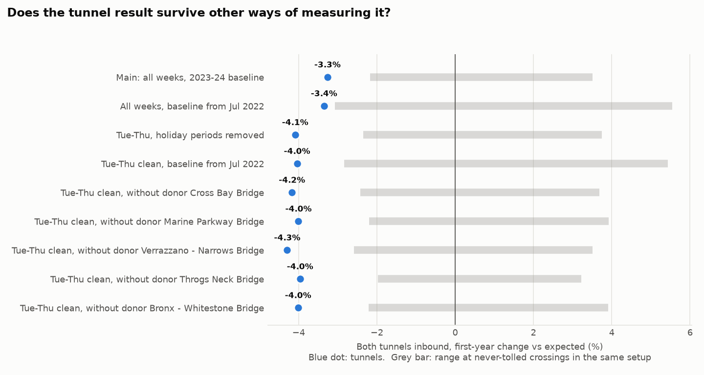
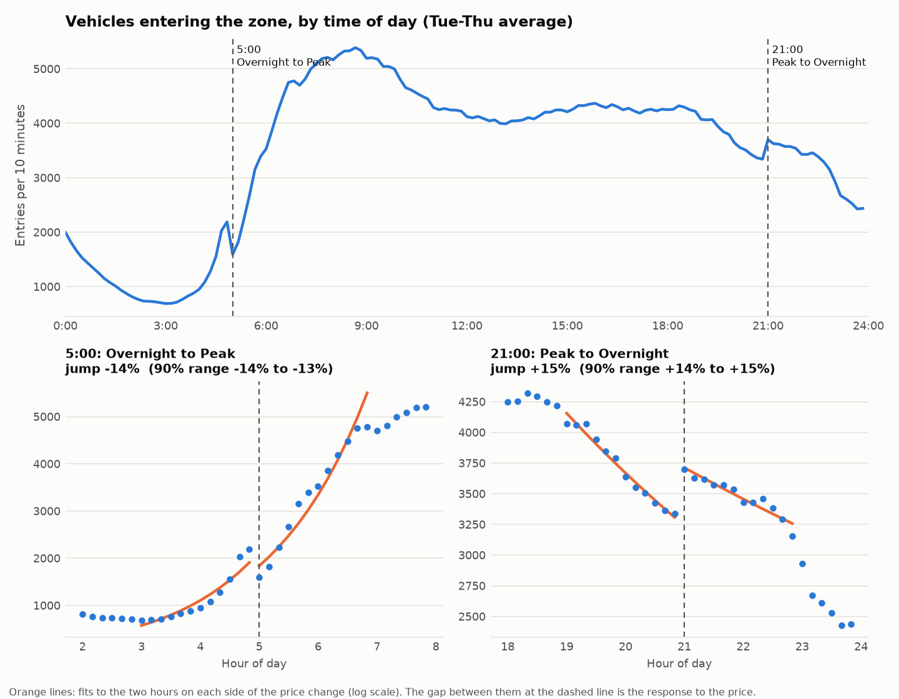

# Did congestion pricing really cut traffic?

An independent look at New York's congestion pricing using only public data. Three questions: **how much traffic left, did drivers shift when they travel, and did traffic move to other roads?**

**Live dashboard:** [soganapawankalyan.github.io/congestion-pricing-analysis/dashboard](https://soganapawankalyan.github.io/congestion-pricing-analysis/dashboard/)

> Independent portfolio project. The data is public (New York State open data). The MTA is mentioned for context only and is not affiliated with this work. A conference slide cited roughly 8% to 14% fewer vehicles entering the zone per day against an October 2023 baseline. I did not verify that figure, and it covers all entry points, which this analysis cannot see.

## What I found (data through October 2026)

| Question | Answer | How sure |
|---|---|---|
| 1. How much traffic left? | About **4% fewer vehicles** at the two tunnels that feed the zone (first year: -3.3% in the main setup, -4.0% to -4.3% in the cleaner Tue-Thu setups). | Consistent in sign across all 9 setups. Borderline against chance: p between 0.09 and 0.18, where 0.09 is the best this test can give. |
| 2. Did drivers shift timing? | **Cars entering just after 21:00, when the price drops, jump about +28%.** | Stable: +28% to +35% across every bandwidth setting, well above the size of jumps at made-up boundaries. |
| 3. Did traffic divert? | About **11-12% of zone entries use untolled roads**, a stable share. Nearby bridges moved little (RFK from the Bronx +3.1%, Henry Hudson +0.7% in the first year). | Descriptive only. |

What the data could **not** show: any stable response at the 05:00 price rise (the estimate crosses zero under some settings for every vehicle group), and a response by taxis, trucks or buses at 21:00.

## Why the number is smaller than headlines

- I can only see **two treated crossings** (Queens-Midtown and Hugh L. Carey tunnels). The zone has many more entry points, and those two are not representative.
- Some drivers get crossing credits at the tunnels, which dampens the toll there.
- Never-tolled "donor" crossings may have absorbed some diverted traffic, which would understate the effect.
- Outbound lanes at the same tunnels dipped by a similar amount (-2.9% and -4.0%). A toll on entering the zone should not do that, so part of the dip is probably not the toll.

## Method in plain language

**Q1, traffic volume.** For each week, compare the tunnels with an index of far-away crossings (Verrazzano, Throgs Neck, Whitestone, Cross Bay, Marine Parkway) and with the same week of the year in 2023-24. The gap that opens after January 5, 2025 is the estimated effect. Because there are only two treated crossings, I do not use textbook standard errors. Instead:
- **Placebo in space:** pretend each never-tolled crossing was tolled and measure the "effect" by chance (n = 10). The tunnel effect is ranked against them.
- **Placebo in time:** pretend the toll started a year earlier. The method should find about nothing (it found -1.1%).
- **Robustness:** Tue-Thu weeks only with holiday periods removed, two baseline starts, and dropping each donor in turn.

**Q2, timing.** Entries are smooth through the day except where the price changes (05:00 and 21:00 on weekdays, read from the data's own labels). I fit a curve on each side of the boundary on a log scale and measure the jump at the boundary. Checks: resampling days for a 90% range, a bandwidth/order grid, and a **fake-boundary test** that applies the same estimator at made-up times and reports how big jumps look by chance.

**Q3, diversion.** The same Q1 estimator on bridges that approach the zone, the share of entries on untolled roads, and a reconciliation of the zone file against bridge-and-tunnel counts at the two tunnels.

## Assumptions and data notes

- Baseline is January 2023 to the day before the toll (avoids pandemic years). Weeks run Sunday to Saturday, complete weeks only.
- Bridge-and-tunnel timestamps are UTC-shifted, so the analysis uses the `date` and `hour` fields.
- Zone entries are stitched trips; taxis and for-hire vehicles are their own class.
- The zone file starts with the toll, so there is no pre-period for zone-wide totals.
- The zone file runs about 2-3% above the tunnel counts (one month at the Carey Tunnel is an outlier I did not investigate). A third-party write-up reported a similar gap versus an MTA report; I have not explained it.
- Diversion checks are descriptive, not causal.

## Reproduce it

```bash
python3 -m venv .venv && source .venv/bin/activate
python3 -m pip install pandas numpy matplotlib
python3 01_download_data.py        # pulls data from data.ny.gov into data/raw (a few minutes)
python3 02_analysis.py             # results/*.csv and figures/*.png
python3 03_build_dashboard.py      # dashboard/index.html
open dashboard/index.html
```

Data: dataset ids `ebfx-2m7v` (bridge and tunnel crossings) and `t6yz-b64h` (zone vehicle entries) on data.ny.gov. Raw data is not committed; the download script recreates it.

## Files

| File | Purpose |
|---|---|
| `01_download_data.py` | Server-side aggregated downloads from data.ny.gov (standard library only) |
| `02_analysis.py` | All estimates, placebo tests, robustness, figures |
| `03_build_dashboard.py` | Builds the self-contained dashboard from `results/*.csv` |
| `dashboard/` | `template.html` and the generated `index.html` |
| `results/`, `figures/` | Output tables and charts |

## Figures




